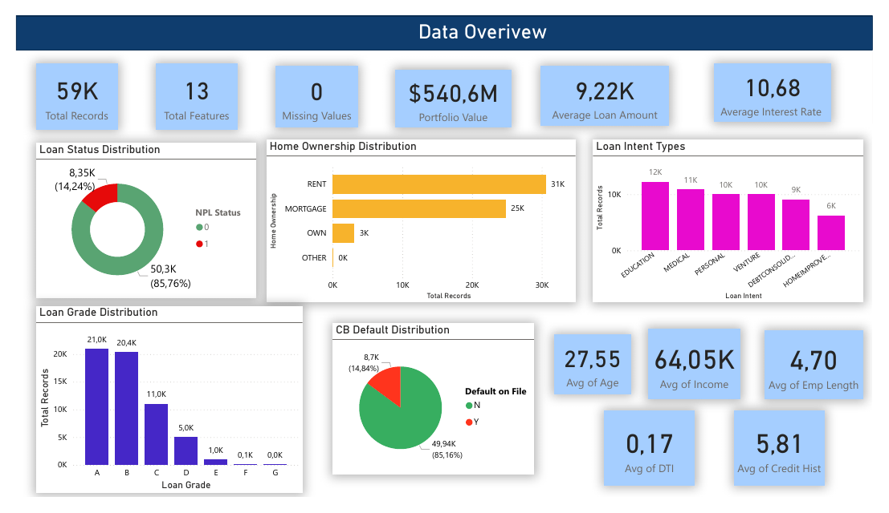
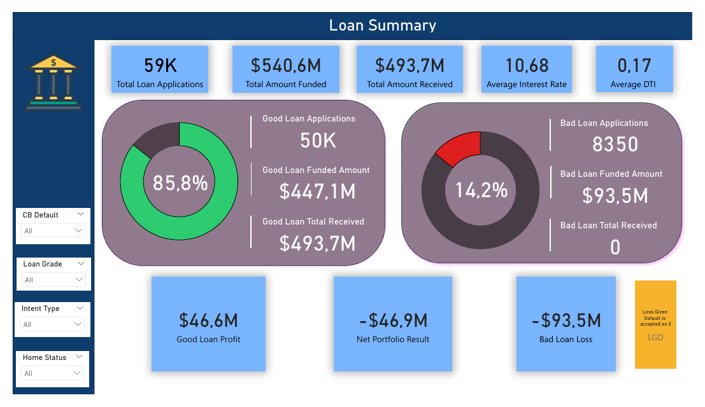
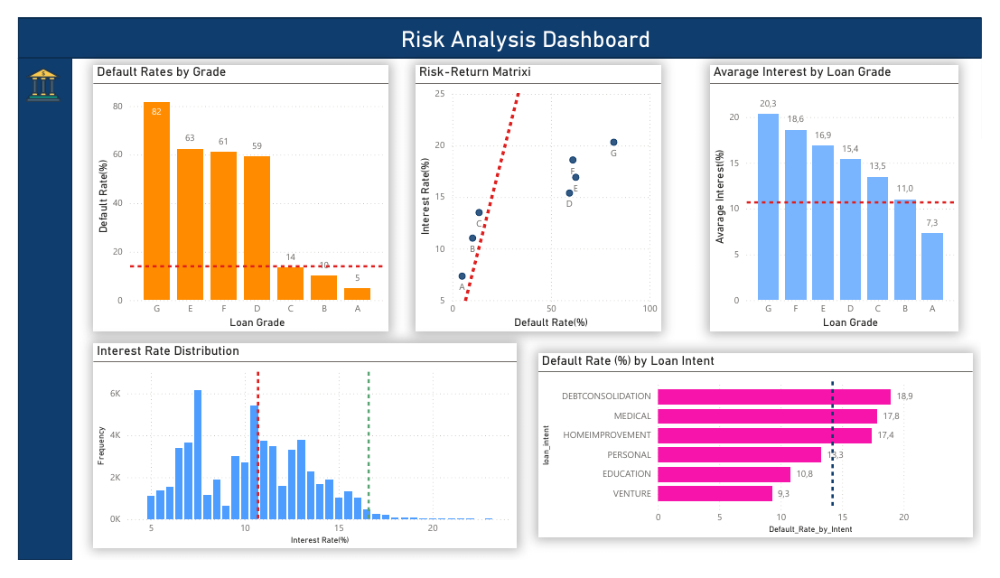

# Credit Risk & Loan Default Prediction

Graduation project for the Miuul Data Analytics & Machine Learning Bootcamp.
An end-to-end look at a 58,645-loan portfolio: a business analysis of where the portfolio makes and loses money, a Power BI dashboard for decision-makers, and a machine learning model that flags likely defaults before a loan is approved.

## The problem

The portfolio carries a 14.2% default rate at an average interest rate of 10.7%. Assuming a defaulted loan is a full loss, it returns **−5.1% net**. The questions were:

1. Which segments are losing money, and why?
2. What would pricing need to look like to break even?
3. Can we predict which applicants will default, so risky loans are caught before approval?

## Key findings

- **Only Grade A loans are profitable** (+2.1% net return). Grades D–G default at 59–82% while charging only 15–20% interest.
- **Break-even needs ~16.6% average interest**, about 6 points above current pricing. Every 1-point drop in default rate is worth ~1.2 points of net return, so better risk screening pays off faster than raising rates.
- **Loan purpose matters:** debt consolidation, medical, and home improvement loans default most (17–19%); venture and education loans least (9–11%).

## The model

| Step | What I did |
|---|---|
| Data prep | Outlier capping (5th–95th percentile), checks for impossible values (e.g. employment length longer than age) |
| Feature engineering | Grew 13 raw columns to 37: debt-to-income, payment burden, stability index, income × grade interaction, age and income brackets, a rule-based risk score |
| Feature selection | Compared mutual information, RFE, Lasso, and Random Forest / XGBoost importance; dropped highly correlated features |
| Models | Decision Tree, Random Forest, CatBoost (tuned with grid search, SMOTE, and class weights) |
| Decision threshold | Tuned to catch **80% of defaults**, the business priority, rather than maximise accuracy |

**Final model — CatBoost at the tuned threshold:**

| ROC AUC | PR AUC | Recall (defaults caught) | Precision | Accuracy |
|---|---|---|---|---|
| 0.953 | 0.870 | 80.0% | 78.4% | 94.0% |

At the same 80% recall, CatBoost raised about half as many false alarms as Random Forest (554 vs 1,204 good applicants wrongly flagged), so far fewer good customers would be turned away.

The dashboard's Model page shows a separate run of the same CatBoost approach with 10-fold stratified cross-validation and randomized search (ROC AUC 0.956, recall 83%, precision 70.5%).

## Power BI dashboard

Seven pages: data overview, loan summary (funded vs. received, profit and loss), risk analysis by grade and purpose, cross-segment default rates, net return by grade, the default-rate vs. return relationship, and model results.

📄 [Full dashboard as PDF](PowerBI_Dashboard.pdf) · 📊 [Power BI file (.pbix)](loan-status.pbix)

## Files

| File | Contents |
|---|---|
| `Credit_Risk_Default_Prediction.ipynb` | Full analysis and modeling (Python, comments in Turkish) |
| `PowerBI_Dashboard.pdf` | All dashboard pages |
| `loan-status.pbix` | Power BI source file |

**Tools:** Python (pandas, scikit-learn, CatBoost, XGBoost, imbalanced-learn), Power BI
**Data:** Kaggle Playground Series S4E10 — Loan Approval Prediction (58,645 rows, 13 features)
